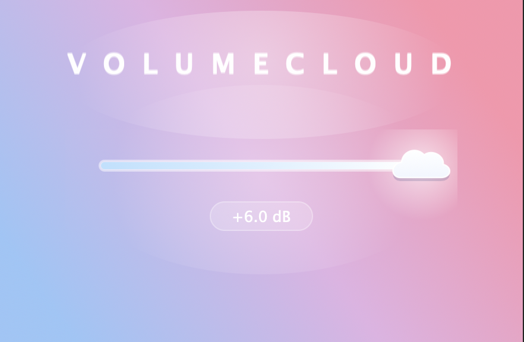

# VolumeCloud | Real-Time C++ Audio Gain Plugin (JUCE 8)

A lightweight, cross-platform digital audio gain plugin built in C++17 with the **JUCE 8** framework. Designed with sample-accurate parameter smoothing and a custom procedural vector graphics pipeline.

## Download & Installation (macOS / Windows / Linux)
Pre-compiled binaries for all platforms are available on the **[Latest Release](../../releases/latest)** page:

### macOS (`VolumeCloud-macOS.zip`)
- **AU (Logic Pro / GarageBand):** Move `VolumeCloud.component` to `/Library/Audio/Plug-Ins/Components/`
- **VST3 (Ableton / Reaper / FL Studio):** Move `VolumeCloud.vst3` to `/Library/Audio/Plug-Ins/VST3/`
- **Standalone App:** Move `VolumeCloud.app` to `/Applications/`

### Windows (`VolumeCloud-Windows-x64.zip`)
- **VST3 (Ableton / FL Studio / Reaper / Cubase):** Move `VolumeCloud.vst3` to `C:\Program Files\Common Files\VST3\`
- **Standalone App:** Run `VolumeCloud.exe` directly from any folder.

### Linux (`VolumeCloud-Linux-x64.zip`)
- **VST3:** Move `VolumeCloud.vst3` to `~/.vst3/` or `/usr/lib/vst3/`
- **Standalone App:** Run `./VolumeCloud` directly.

## Key Engineering Features
- **Zero-Zipper Gain DSP:** Implements sample-accurate linear interpolation (`juce::LinearSmoothedValue`) with a 50ms ramp to eliminate discontinuity artifacts during rapid gain changes, automatically bypassing per-sample loops when static for optimal CPU efficiency.
- **Custom Vector UI (`juce::LookAndFeel_V4`):** Custom procedural cloud slider thumb, frosted glass track rendering, and dynamic multi-stop gradient shading with zero external image dependencies.
- **Logarithmic Decibel Mapping:** Converts linear amplitude multipliers (`0.0` to `2.0`) to decibel readouts (`-inf dB` to `+6.0 dB`).
- **Binary State Serialization:** Persists parameter state across editor lifecycles and DAW project saves via `MemoryOutputStream` and `MemoryInputStream`.
- **Automated Cross-Platform CI/CD:** Uses GitHub Actions to automatically compile native **AU**, **VST3**, and **Standalone** binaries across **macOS**, **Windows (MSVC)**, and **Linux (GCC/Make)**.

## Project Structure
- `Source/PluginProcessor.h` & `.cpp` — Real-time audio thread processing, linear smoothing, and binary state persistence.
- `Source/PluginEditor.h` & `.cpp` — Custom `CottonCandyLookAndFeel` vector rendering and reactive UI layout.
- `.github/workflows/build.yml` — Multi-OS GitHub Actions CI/CD build pipeline.
- `VolumeCloud.jucer` — Projucer cross-platform project configuration.

## Build From Source (Developers)
1. Open `VolumeCloud.jucer` in **Projucer** (JUCE 8+).
2. Select your target OS exporter (**Xcode (macOS)**, **Visual Studio 2022 (Windows)**, or **Linux Makefile**) and save to generate project files.
3. Open the generated project in your IDE and build the **VolumeCloud - All** target in `Release` mode.
